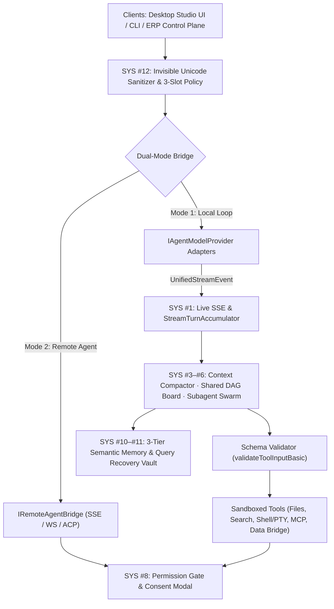
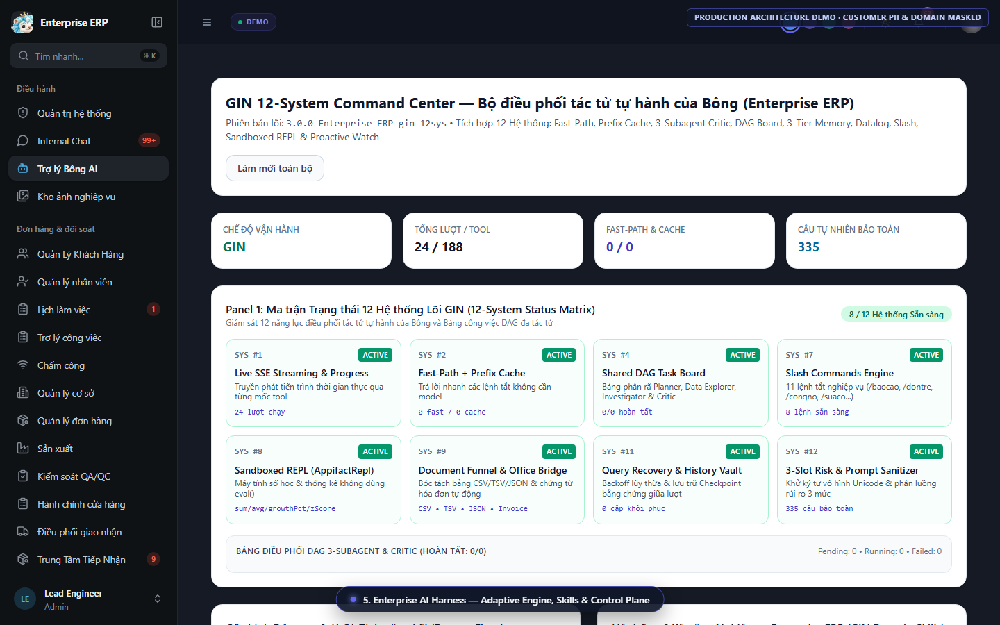
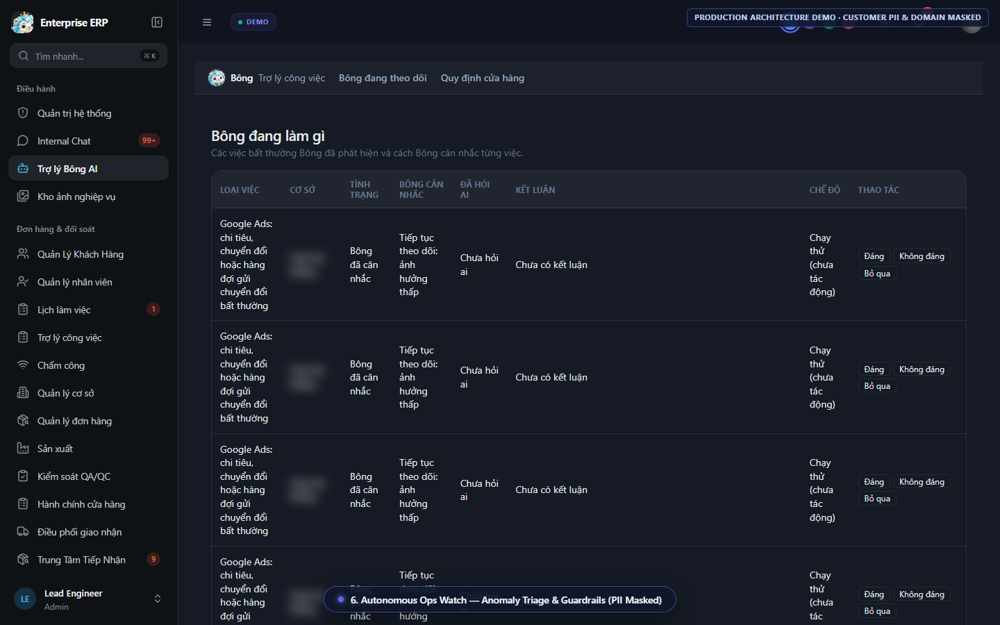
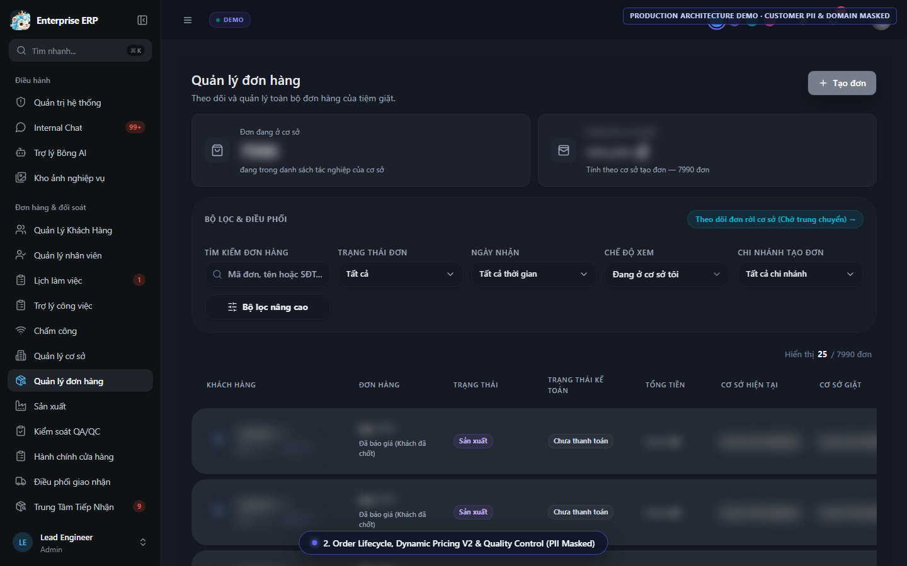
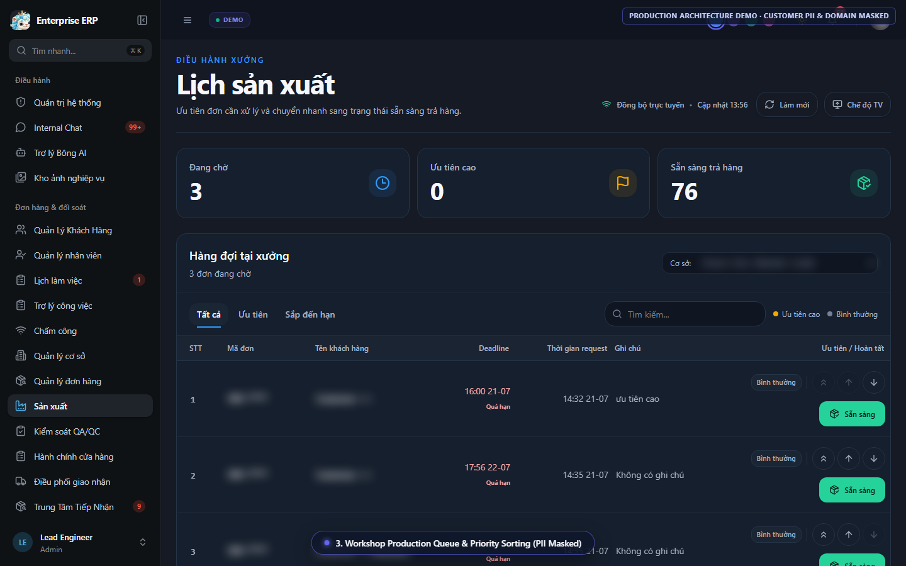
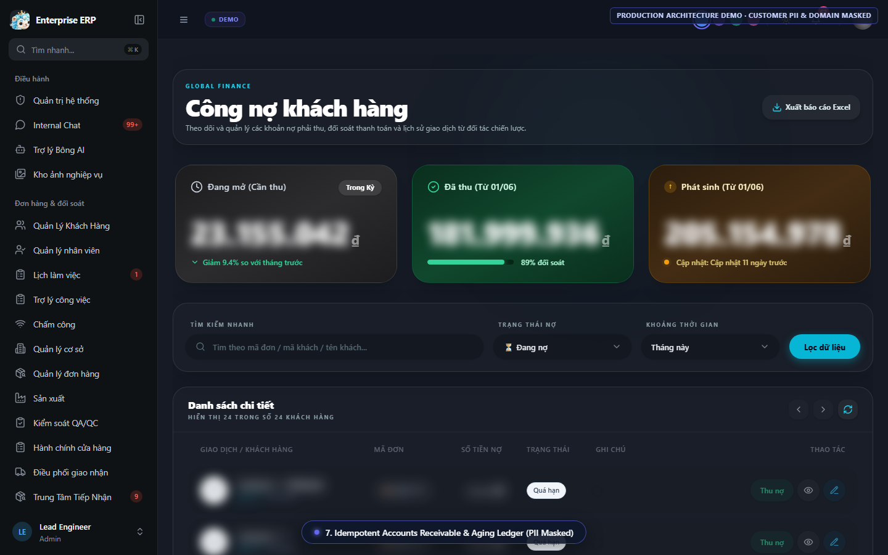

# GIN Harness — Multi-Agent Swarm Architecture & Sanitized TypeScript Modules

> **Open Architecture Showcase** by **Phạm Văn Thịnh** (`phamvanthinhcontact2004@gmail.com`)  
> 4th-Year IT Student (HUBT · GPA 3.7/4.0) · Full-Stack TypeScript & AI Agent Systems Engineer  
> Available for Remote Work (Upwork · Async English Chat/Docs · `$8–$12/hr`)

---

## Notice on Repository Scope

This public repository is an **architecture showcase & sanitized sample extraction** derived from two private production systems I engineered:

1. **GIN Autonomous Coding Agent & Multi-Agent Swarm Harness (`anhthinhvup/gin-agent`, private)** — A 6-workspace TypeScript monorepo (`protocol`, `providers`, `tools`, `agent-core`, `cli`, `desktop`) implementing dual-mode multi-provider LLM orchestration, DAG swarm coordination, context compaction, permission gates, and prompt-injection defense.
2. **Production Enterprise ERP & Autonomous Ops Control Plane (`private`)** — Live multi-branch operations platform powered by the GIN 12-System AI Command Center.

To protect proprietary commercial logic, internal system prompts, and customer privacy, private business modules and credentials are kept in private repositories. What you see here compiles cleanly under TypeScript `strict: true`, includes real unit tests and reproducible Node.js micro-benchmarks, and embeds anonymized screenshots from the live control plane.

---

## System Architecture (12-System Control Plane & Dual-Mode Harness)



### 12-System Capability Matrix (Private Monorepo Architecture)

| System | Subsystem | Key Technical Responsibilities |
|---|---|---|
| **SYS #1** | Live SSE Streaming & Progress | Unified `UnifiedStreamEvent` protocol + `StreamTurnAccumulator` across heterogeneous providers |
| **SYS #2** | Fast-Path & Prefix Cache Auditor | Hash-verified prompt prefix reuse + hot-swappable `ginmsg`, `openai-compatible`, `gemini`, `ollama` profiles |
| **SYS #3** | Multi-Tier Context Compaction | Micro-compaction, reactive threshold compaction, and precomputed snapshot restoration |
| **SYS #4** | Shared DAG Task Board & Swarm | Coordinated teammate swarm execution, dependency-aware task claiming, and cycle guards |
| **SYS #5** | Subagent Orchestration & Critic | Isolated role subagents (`planner`, `explorer`, `reviewer`) with bounded budgets |
| **SYS #6** | Datalog Unification & Reactive State | Declarative fact matching and reactive state propagation across agent turns |
| **SYS #7** | Slash Commands & Fast-Path | Deterministic operator shortcuts bypassing unnecessary model round-trips |
| **SYS #8** | Permission Guard & Tool Execution | Recursive JSON-schema validation, risk classifier, auto-mode evaluator, and live diff consent |
| **SYS #9** | Document & Structured Funnel | Safe `CSV` / `TSV` / `JSON` ingestion and cross-verification bridge |
| **SYS #10** | 3-Tier Semantic Memory | Indexed memory selector + built-in operational playbooks |
| **SYS #11** | Query Recovery & History Vault | Orphan repair, refusal recovery, and resumable turn checkpoints |
| **SYS #12** | Prompt Sanitizer & Fence Policy | Strips Unicode Tag ASCII smuggling (`U+E0000..U+E007F`), Trojan Source bidi overrides, and zero-width obfuscation |

---

## Included Sanitized TypeScript Modules

| Path | Origin Package | What It Demonstrates |
|---|---|---|
| [`packages/protocol/src/messages.ts`](packages/protocol/src/messages.ts) | `@pc-agent/protocol` | Strict discriminated union streaming events (`UnifiedStreamEvent`), `TokenUsage`, `normalizeMessageContent`, and stateful `StreamTurnAccumulator` |
| [`packages/protocol/src/tools.ts`](packages/protocol/src/tools.ts) | `@pc-agent/protocol` | Provider-agnostic `UnifiedToolSchema` and recursive runtime validator `validateToolInputBasic` |
| [`packages/protocol/src/providers.ts`](packages/protocol/src/providers.ts) | `@pc-agent/protocol` | `IAgentModelProvider` & `IRemoteAgentBridge` contracts, provider alias normalization, and `validateProviderProfile` |
| [`packages/security/src/prompt-invisible-sanitizer.ts`](packages/security/src/prompt-invisible-sanitizer.ts) | `@pc-agent/agent-core` | Unicode steganography defense: `stripInvisiblePromptChars`, `detectHiddenPromptInjection`, and non-mutating `sanitizeConversationMessages` |
| [`tests/showcase.test.ts`](tests/showcase.test.ts) | Showcase Test Suite | 6 unit tests covering stream accumulation, nested JSON schema bounds/enums, provider validation, Unicode Tag decoding, and Trojan Source detection |
| [`scripts/bench.ts`](scripts/bench.ts) | Reproducible Benchmark | High-iteration throughput harness (`20,000`–`50,000` calls per path) |

---

## Reproducible Verification & Benchmarks

Verified locally on **Node.js `v24.15.0`** (`tsc --noEmit` strict mode + `node --test` + `scripts/bench.ts`):

- **TypeScript Strict Check:** `npm run typecheck` -> `0` errors
- **Unit Test Suite:** `npm test` -> **`6 / 6` passed** (`0` failed, `0` skipped, `173.15 ms`)
- **Micro-Benchmark Output (`npm run bench`):**

| Benchmark Case | Iterations | Total Time | Throughput | Avg Latency |
|---|---:|---:|---:|---:|
| `stripInvisiblePromptChars` (clean prompt) | 20,000 | 142.19 ms | ~140,662 ops/sec | 7.11 us |
| `detectHiddenPromptInjection` (obfuscated Trojan/ZW) | 20,000 | 138.96 ms | ~143,930 ops/sec | 6.95 us |
| `validateToolInputBasic` (nested schema + bounds/enum) | 50,000 | 34.09 ms | ~1,466,856 ops/sec | 0.68 us |
| `StreamTurnAccumulator` (6-event turn build) | 20,000 | 24.71 ms | ~809,399 ops/sec | 1.24 us |

Run locally in under 10 seconds:

```bash
npm install
npm run typecheck
npm test
npm run bench
```

---

## Visual Control Plane Showcase (PII & Brand Masked)

All screenshots below were captured from the live Next.js / TypeScript production ERP using an automated Playwright privacy-masking pipeline (`domain/brand`, `customer PII`, `facility addresses`, and `exact currency totals` scrubbed/blurred):

### 1. GIN 12-System AI Command Center


### 2. Autonomous Ops Watch (Anomaly Triage & Guardrails)


### 3. Multi-Branch Order Lifecycle (PII Masked)


### 4. Workshop Production Queue & Priority Sorting (PII Masked)


### 5. Idempotent Accounts Receivable & Aging Ledger (PII Masked)

